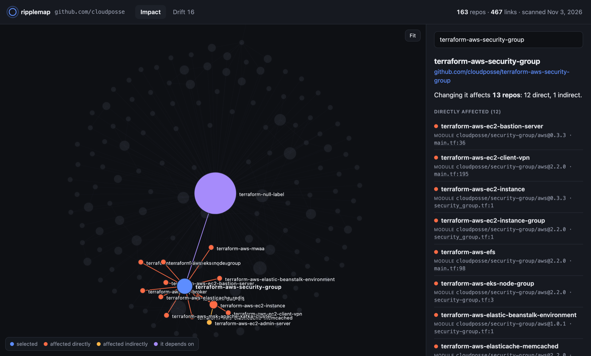

# ripplemap

**See which repos are affected when you change one.**

You're about to bump the shared base image, change a Terraform module, or edit the reusable CI workflow. Which repos use it? Which are still on the old version? Usually the answer lives in someone's head or a stale wiki page.

ripplemap reads the files your repos already have (Dockerfiles, Terraform, GitHub Actions workflows, `package.json`, Compose files) and builds the cross-repo dependency graph. You don't write any catalog YAML, and nothing leaves your machine.

```
$ ripplemap impact base-images

base-images
├─ api  image ghcr.io/acme/base:1.4  Dockerfile:1
│  └─ frontend  image ghcr.io/acme/api:latest  docker-compose.yml:3
└─ web  image ghcr.io/acme/base:1.2  Dockerfile:1

3 repos affected: 2 direct, 1 indirect.
```

`frontend` never mentions `base-images`. It runs the `api` image, which is built on top of it. ripplemap follows that chain.

`ripplemap report` turns the same graph into a single HTML page you can open offline or share. Click a repo to see everything a change to it would affect:



## Quick start

Requires Node.js 20 or newer. Point it at your GitHub org; you don't need to clone anything:

```bash
npx ripplemap scan --org my-org
npx ripplemap report        # writes ripplemap.html
npx ripplemap impact <repo>
npx ripplemap drift
```

It uses `GITHUB_TOKEN`, `GH_TOKEN`, or your `gh auth login` session, so private repos work too. Only the files ripplemap reads are downloaded, and they're cached by content. Scanning Cloud Posse's 163 Terraform repos took 25 seconds the first time. Repeat scans take about 5 seconds and 3 API requests, because only repos with new pushes are fetched again.

Already have the repos cloned? Scan the folder instead:

```bash
npx ripplemap scan ~/code/my-org
```

Or install it globally with `npm install -g ripplemap`.

## Commands

### `ripplemap scan --org <name>` / `ripplemap scan <dir>`

Scans a GitHub org or user through the API, or a folder of cloned repos (or a single repo), and writes `ripplemap.json`.

| Option | |
|---|---|
| `--org <name>` | GitHub org or user to scan without cloning |
| `--match <glob>` | With `--org`: only repos whose name matches, e.g. `terraform-*`. Repeatable. |
| `--include-forks`, `--include-archived` | With `--org`: forks and archived repos are skipped by default |
| `--no-cache` | With `--org`: don't read or write the download cache (`~/.cache/ripplemap`) |
| `--owner <org>` | With a folder: org name for repos without a git remote |
| `--exclude <dir>` | Skip a folder name (`examples`) or repo-relative path (`test/fixtures`). Repeatable. |
| `--out <file>` | Where to write the graph (default `ripplemap.json`) |
| `--verbose` | Show files that could not be read or parsed |

### `ripplemap impact <repo>`

Every repo that depends on `<repo>`, directly or through other repos, with the file and line of each reference. `--json` for scripting.

### `ripplemap drift`

Shared things used at more than one version. Here it is on all 163 of [Cloud Posse](https://github.com/cloudposse)'s Terraform module repos, with examples and tests excluded. They're a well-run org that uses Renovate, and 16 of their own modules are still used at mismatched versions:

```
$ ripplemap scan --org cloudposse --match 'terraform-*' --exclude examples --exclude test
$ ripplemap drift --internal

cloudposse/security-group/aws  module · built in terraform-aws-security-group · 3 versions across 12 repos
  2.2.0  terraform-aws-ec2-client-vpn, terraform-aws-ec2-instance-group, terraform-aws-efs +5 more
  1.0.1  terraform-aws-elastic-beanstalk-environment, terraform-aws-mwaa
  0.3.3  terraform-aws-ec2-bastion-server, terraform-aws-ec2-instance

cloudposse/utils/aws  module · built in terraform-aws-utils · 2 versions across 3 repos
  1.4.0     terraform-aws-config, terraform-aws-dynamic-subnets
  unpinned  terraform-aws-github-action-token-rotator
```

| Option | |
|---|---|
| `--internal` | Only things built in your scanned repos (hides `actions/checkout` and similar) |
| `--kind <kind>` | `image`, `terraform-module`, `workflow`, `action` or `npm`. Repeatable. |
| `--fail` | Exit with code 1 when drift is found, so you can run it in CI |
| `--json` | Full output for scripting |

### `ripplemap report`

Writes `ripplemap.html`: one self-contained page with an interactive graph, the impact of any repo, and the drift table. It has no external scripts or fonts, so it works offline and can be attached to a ticket or posted in Slack. File references link straight to the line on GitHub. Add `#repo=<owner/name>` to the URL to open the page with that repo selected.

| Option | |
|---|---|
| `--graph <file>` | Graph to read (default `ripplemap.json`) |
| `--out <file>` | Where to write the page (default `ripplemap.html`) |

## What it understands

| File | Uses | Produces |
|---|---|---|
| `Dockerfile`, `*.dockerfile`, `Containerfile` | `FROM` and `COPY --from` images (resolves `ARG` defaults, skips build stages) | |
| `*.tf` | `module` sources: git (`git::`, `github.com/...`), and registry (`org/name/provider`) | the module, by repo name |
| `.github/workflows/*.yml`, `action.yml` | actions, reusable workflows, `docker://` images | images pushed with `docker/build-push-action`, `docker/metadata-action`, or `docker push` |
| `package.json` | `dependencies`, `devDependencies`, `peerDependencies`, `optionalDependencies` | the package `name` |
| `compose.yml`, `docker-compose*.yml` | service `image`s | |

### How references are linked to repos

Every link carries a confidence level so you know how much to trust it:

- **exact**: the reference names the repo (`acme/ci/.github/workflows/build.yml@v2`, `git::https://github.com/acme/modules.git//vpc`). Terraform registry modules count too, since registries only publish repos named `terraform-<provider>-<name>`.
- **declared**: another repo declares it produces the thing (a `package.json` `name`, an image push in CI).
- **convention**: guessed from naming, e.g. `ghcr.io/acme/api` is probably built by `acme/api`. These are marked `(guessed from name)` in the output.

### Known limits

- It reads files, not traffic. Service A calling service B over HTTP is invisible unless a config file names it. Your APM tool covers that side.
- Images whose names are built entirely from CI variables can't be resolved statically and are skipped.
- When scanning a folder, repos are found one level deep: `repos/<repo>`. Nested layouts aren't supported yet.
- `--org` works with github.com only. GitHub Enterprise Server isn't supported yet.
- The Terraform and GitHub Actions parsing has been checked against real public repos. The Docker and npm linking has so far only been tested on the fixtures in `test/fixtures`. Bug reports with real-world files are very welcome.

## Roadmap

- A GitHub Action that comments "this PR affects N repos" on pull requests
- More parsers: Kubernetes manifests, Helm charts, `go.mod`, Python packages

Check the [issues](https://github.com/Zintrivious/ripplemap/issues). The ones labeled `good first issue` are self-contained.

## Contributing

Adding a parser is the easiest way in. A parser is one file with a `matches(file)` and a `parse(...)` function, and you don't need to touch the rest of the code. [CONTRIBUTING.md](CONTRIBUTING.md) walks through it.

## License

MIT
